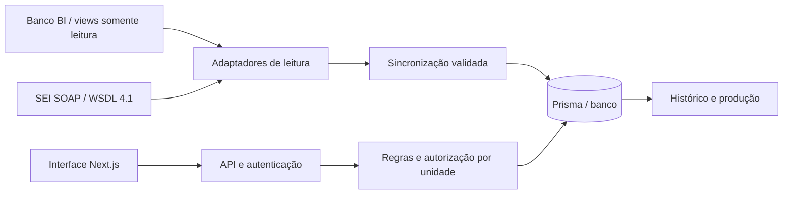

# Plano e estado da primeira versão

Data: 23/10/2026.

## Análise da referência

Foram examinados README, manifests, schema Prisma, autenticação, permissões, componentes e referências a BI/SEI de `servin-controle-main`. A aplicação separa Next.js e NestJS, com PostgreSQL, servidores, divisões, processos, eventos, ofícios, grupos e arquivo. Não foi encontrada integração BI/SEI implementada nos serviços examinados; SEI aparece como sistema de origem do cadastro.

A nova aplicação concentra interface e backend no Next.js App Router: Server Components para consultas, Route Handlers para comandos e Prisma para persistência. Referências: [Route Handlers](https://nextjs.org/docs/13/app/building-your-application/routing/route-handlers) e [cookies](https://nextjs.org/docs/app/api-reference/functions/cookies).

O banco operacional utiliza MySQL 8.4 via Docker Compose, com migração própria, volume persistente e porta local 3307. O schema e as migrações SQLite originais estão arquivados em `prisma/legacy-sqlite`; seus dados não são transferidos automaticamente. O BI SQL Server permanece separado.

## Dados e regras

| Fonte | Dados | Responsabilidade |
|---|---|---|
| BI | Identificador, assunto, imóveis, interessados, unidade/situação externas | Leitura; complementos locais preservados |
| SEI | Status e eventos com ID/data da origem | Histórico externo; não gera produção automaticamente |
| Módulo | Distribuição, prioridade, observações, atividades e encerramento | Operações autorizadas e auditadas |

- Número e ID BI são únicos. Cadastro manual vincula pelo número exatamente igual. Conflitos interrompem o lote; não há fusão silenciosa.
- Redistribuição encerra atribuição anterior e cria nova, preservando períodos e autoria das atividades abertas. Não inicia análise.
- Situação, instância, decisão e encerramento são separados. Decisões/recursos ainda precisam de fluxo de interface completo.
- Técnico registra atividade na própria carteira; administrativo registra categoria administrativa; gestão distribui, altera situação e encerra.
- Consulta não altera registros. Admin tem acesso global; demais perfis ficam limitados às unidades vinculadas, inclusive em exportações.
- Comandos gravam alteração e histórico na mesma transação. Versão desatualizada impede perda silenciosa.
- Atividades simultâneas são admitidas provisoriamente, sem soma de horas de esforço. A regra definitiva precisa de validação.
- Encerramento exige conclusão das atividades abertas. Status externo não encerra automaticamente.
- Falha de integração preserva a base anterior; ausência em snapshot completo apenas sinaliza.
- Eventos SEI mantêm ocorrência. Status sem data é registrado como observação no instante da consulta, explicitamente identificado.

## Indicadores

Períodos usam dias completos em America/Sao_Paulo.

| Indicador | Definição |
|---|---|
| Ativos | Sem data de encerramento |
| Sem distribuição | Ativos sem atribuição vigente |
| Iniciadas | Início no intervalo |
| Concluídas | Término no intervalo |
| Abertas no fim | Início até o fim e sem término até esse instante |
| Duração média decorrida | Média término menos início das concluídas; ausência é “Sem dados” |

Produção utiliza usuário e unidade persistidos na atividade, não responsável atual. Duração inclui esperas, não equivale a horas trabalhadas. Volume não mede complexidade/qualidade. Não se infere produção de tramitação SEI. Última ação local usa a data de registro; eventos retroativos também preservam sua ocorrência.

## Cobertura e continuidade

| Área | Entregue | Próximas entregas |
|---|---|---|
| BI | Contrato interno, incorporação, vínculo manual, sincronização, logs, ausência e cache | Driver do SGBD, SELECT nas views reais, leitura consistente e universo por unidade |
| Processos | Cadastro básico, múltiplos vínculos no modelo/BI, busca, filtros e ficha | Urbanismo/incidências, edição múltipla local, relacionados, normalização |
| Distribuição | Atribuição, redistribuição, carteira e períodos | Organograma coordenadoria/divisão e regras interunidades |
| Atividades/situação | Autoria, datas, conclusão, status, encerramento/reabertura | Catálogos, decisões/publicações/recursos e correções auditadas |
| Grupos/ofícios/arquivo | Catálogo inicial, vínculo, ofícios com andamento, localização histórica | CRUD de grupos, campos completos e paginação auxiliar |
| Relatórios | Carteira, produção por unidade/técnico/período, CSV da carteira | CSV de produção, permanência por situação e decisões |
| Acesso | Sessão local, perfis, unidades, histórico e versão | SSO, gestão de usuários, recuperação e rate limit distribuído |
| Migração | Planejamento | Prévia, mapeamento revisado, lotes e origem da planilha |
| UX | Layout responsivo, labels, foco, erros e contexto na volta | Aviso de alterações não salvas, WCAG completo e testes com usuários |

Busca está na URL para preservar navegação; não inserir dados pessoais sensíveis. Antes da operação institucional, mover pesquisas sensíveis para sessão/POST e revisar logs. DSIMP/DSIGP são unidades independentes provisórias, sem hierarquia. Catálogos e usuários são exemplos.

## Sequência de evolução

1. Manual SEI 4.1 lido: conector SOAP implementado e pendente de homologação do WSDL real. BI confirmado como banco direto: identificar SGBD/views e mapear IDs, campos, datas, unidades e escopo antes de implementar o driver/SELECT.
2. Integrar autenticação institucional, organograma e permissões; preparar backup e recuperação do MySQL.
3. Completar urbanismo, decisões/recursos, catálogos e importação com prévia revisada.
4. Ampliar relatórios; validar histórico confiável, acessibilidade e tarefas com representantes dos perfis.

## Testes

Banco temporário cobre datas inválidas, fórmulas CSV, bloqueio por unidade, versão concorrente, redistribuição preservando autoria, sincronização idempotente, rollback do lote inválido, ausência BI e encerramento/reabertura. Navegador cobre login, carteira, detalhe, relatórios e viewport estreita.
